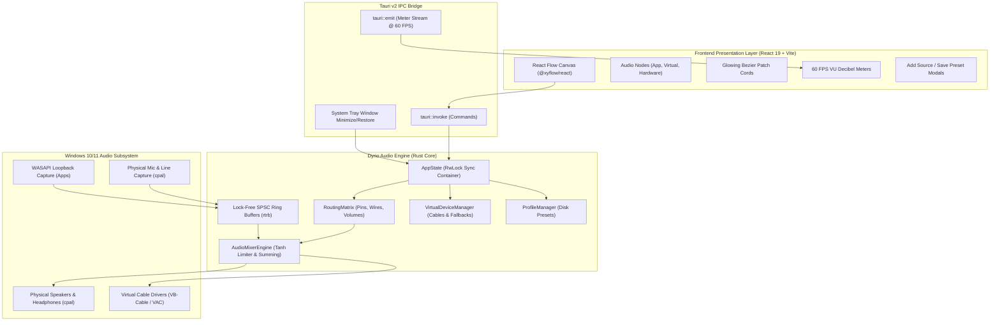

# Dyno Virtual Audio Mixer

[](https://github.com/realkhoa/DynoVirtualAudioMixer/actions/workflows/build.yml)

High-performance, ultra-low-latency virtual audio patchbay and routing matrix desktop application for Windows, built with Tauri v2, Rust WASAPI native audio engine, and React Flow.

---

## 1. Overview & Purpose

Dyno Virtual Audio Mixer delivers Rogue Amoeba Loopback feature parity natively on Windows 10 and 11. Designed with a lightweight footprint (<50MB RAM) and a sleek dark studio aesthetic, Dyno allows musicians, live streamers, podcasters, sound engineers, and power users to intercept, combine, re-route, and balance audio streams from individual Windows applications and physical hardware endpoints with sub-millisecond internal routing latency.

### Key Capabilities
- **Application Audio Capture & Interception:** Intercept sound from individual processes (Spotify, Discord, Chrome, Ableton Live, Steam games) using Windows WASAPI Process Loopback.
- **Hardware Patchbay Matrix:** Seamlessly route physical microphones, audio interfaces, and line inputs to multiple output endpoints simultaneously.
- **Virtual Audio Cable Integration:** Inject mixed audio directly into Zoom, Discord, OBS, or Microsoft Teams via VB-Cable, Virtual Audio Cable (VAC), or built-in software loopback fallback endpoints.
- **Smart Stereo Auto-Pairing:** Connecting Left channel (pin 0) automatically pairs and connects the corresponding Right channel (pin 1) if both endpoints support stereo, drastically accelerating patchbay setup.
- **Wire Gain, Wire Mute & 180° Phase Inversion (Ø):** Click any connection cord to fine-tune individual cable gain (-60 dB to +6 dB), mute specific wires, or flip phase by 180 degrees to cancel out phase issues between multi-mic setups.
- **Dedicated Monitors with Feedback Protection:** Mark any output destination as a personal monitor with one-click "Mute When Monitoring" to isolate audio and eliminate echo during live speech.
- **Multi-Channel Virtual Buses (2, 4, 8, 16 Channels):** Allocate multi-track buses for professional DAWs (Ableton, FL Studio, Reaper) and 7.1 surround sound mastering.
- **Hardware Hotplug Watchdog & Fallback Routing:** Automatic endpoint health monitoring dynamically reroutes audio to fallback devices when USB headsets or interfaces are disconnected.
- **DSP Noise Gate Filter:** Real-time exponential envelope noise gate suppresses ambient fan/room noise on microphone inputs with configurable threshold (-60 to -20 dBFS).
- **Sidechain Auto-Ducking:** Automatically attenuates background music/game audio whenever voice activity is detected on the streamer or podcast host microphone.
- **Embedded Localhost REST API Server (`127.0.0.1:49152`):** Zero-dependency HTTP automation server for Elgato Stream Deck, OBS Studio webhooks, and Home Assistant integration.
- **Floating Compact Mini Bar Mode:** Ultra-compact horizontal mixer overlay designed for uninterrupted gaming and live streaming.
- **Real-Time 60 FPS Peak Decibel Metering:** Animated VU meters on every node and glowing Bezier patch cords with signal-reactive neon glow effects.
- **Tanh Soft-Saturation Limiter:** Zero-allocation hyperbolic tangent (`tanh`) soft-knee limiter prevents digital clipping when summing multiple high-amplitude audio streams.
- **Preset Profile Management:** Save, load, list, and switch complex routing configurations on disk with JSON persistence.
- **Background Tray Minimization:** Minimize to the Windows notification tray to keep active audio routing alive without cluttering the taskbar.

### System Architecture Diagram



---

## 2. Prerequisites & Dependencies

### Runtime & Hardware Prerequisites
- **Operating System:** Windows 10 (Build 19041 20H1 or newer) or Windows 11 x64 / ARM64.
- **Hardware:**
  - Any multi-core CPU (Intel Core i3+ or AMD Ryzen 3+).
  - Minimum 4 GB RAM (<50 MB consumed by Dyno).
  - Any DirectX / WASAPI-compatible sound card, DAC, or onboard audio chip.
- **Virtual Audio Driver (Optional but recommended):**
  - [VB-Audio Virtual Cable](https://vb-audio.com/Cable/) or [Virtual Audio Cable (VAC)](https://vac.muzychenko.net/).
  - If no physical driver is installed, Dyno gracefully falls back to its built-in `SoftwareLoopbackEndpoint`.

### Development & Build Dependencies
- **JavaScript Runtime & Package Manager:** [Bun](https://bun.sh/) v1.3.0 or higher.
- **Rust Toolchain:** Stable Rust compiler (`rustc` & `cargo`) v1.75.0 or higher.
- **C++ Compiler & Windows SDK:** Microsoft Visual Studio C++ Build Tools (MSVC v143 / v144) with Windows 10/11 SDK.
- **Web Runtime:** Microsoft Edge WebView2 Evergreen Runtime (included with Windows 10/11).

### Key Dependency Manifest
| Component | Library / Package | Version | Purpose |
| :--- | :--- | :--- | :--- |
| **Frontend** | `react` / `react-dom` | `^19.0.0` | UI component tree and rendering |
| **Frontend** | `@xyflow/react` | `^12.4.2` | Interactive node graph patchbay canvas |
| **Frontend** | `tailwindcss` | `^3.4.17` | Utility-first styling with custom zinc & neon palettes |
| **Frontend** | `lucide-react` | `^0.477.0` | Crisp modern audio, cable, and control icons |
| **Backend** | `tauri` | `^2.12.5` | Lightweight native desktop shell and window manager |
| **Backend** | `cpal` | `^0.15.3` | Cross-platform audio I/O & WASAPI stream handling |
| **Backend** | `rtrb` | `^0.3.6` | Wait-free Single-Producer Single-Consumer audio ring buffer |
| **Backend** | `windows` / `windows-rs` | `^0.58.0` | Direct Win32 / COM WASAPI audio session interfaces |
| **Backend** | `serde` / `serde_json` | `^1.0.229` | High-throughput binary and JSON serialization |

---

## 3. CLI Options & Arguments Reference

The following commands can be executed from the project root using Bun and Cargo:

| Command | Category | Default / Target | Description |
| :--- | :--- | :--- | :--- |
| `bun run dev` | Development | `http://localhost:1420` | Starts Vite local dev server with HMR for frontend development. |
| `bun run build` | Build | `dist/` | Runs TypeScript compiler (`tsc`) and bundles optimized production web assets. |
| `bun test` | Testing | All `*.test.ts(x)` | Runs fast Bun unit and integration test runner for frontend graph helpers. |
| `bun run preview` | Testing | `http://localhost:4173` | Previews production build bundle locally. |
| `bun run tauri dev` | Development | Desktop App | Boots the complete native Tauri desktop application with Rust backend and HMR frontend. |
| `bun run tauri build` | Production | `src-tauri/target/release/bundle/` | Builds optimized release executable (`.exe`) and Windows installer (`.msi` / `.exe`). |
| `cargo check --manifest-path src-tauri/Cargo.toml` | Rust Validation | Debug | Compiles and validates Rust backend code and dependencies without linking binaries. |
| `cargo check --manifest-path src-tauri/Cargo.toml --release` | Rust Validation | Release | Validates release profile optimization passes with zero warnings. |
| `cargo test --manifest-path src-tauri/Cargo.toml` | Rust Testing | Debug | Executes all 43 Rust unit, integration, and e2e audio smoke tests. |

### Environment Variables Reference
| Variable | Default Value | Description |
| :--- | :--- | :--- |
| `DYNO_PRESETS_DIR` | `%LOCALAPPDATA%\DynoVirtualAudioMixer\presets` | Overrides the target filesystem directory where routing presets are saved. |
| `RUST_LOG` | `info` | Configures logging filter levels (`error`, `warn`, `info`, `debug`, `trace`). |
| `TAURI_DEV_HOST` | `127.0.0.1` | Host address bound by Tauri during development mode. |

---

## 4. Usage Examples

### 1. Initial Setup & Installation
```powershell
# Clone the repository
git clone https://github.com/khoant/DynoVirtualAudioMixer.git
cd DynoVirtualAudioMixer

# Install frontend dependencies using Bun
bun install
```

### 2. Running Full Test Suites
```powershell
# Execute frontend unit test suite
bun test

# Execute backend unit and end-to-end integration test suites
cargo test --manifest-path src-tauri/Cargo.toml
```

### 3. Running in Development Mode
```powershell
# Launch Tauri desktop app in live hot-reload mode
bun run tauri dev
```

### 4. Compiling Production Builds
```powershell
# Build frontend bundle
bun run build

# Validate release backend compilation
cargo check --manifest-path src-tauri/Cargo.toml --release

# Package full desktop production installer
bun run tauri build
```

### 5. Patchbay Cable Routing & Smart Stereo Pairing
- **Adding Audio Sources:** Click the `+ Add Source` button in the top navigation bar to open the modal and select running applications (Spotify, Chrome, Steam) or physical microphones.
- **Connecting Cables:** Click and drag from an output pin (circle handle on the right of a node) to an input pin (handle on the left of a destination node).
- **Auto-Pairing:** When connecting Left (pin 0) to Left (pin 0) between stereo nodes, Dyno automatically creates the corresponding Right (pin 1) to Right (pin 1) patch cord in a single gesture.
- **Adjusting Gain:** Use the horizontal volume slider inside each node card (ranging from 0% to 150%) or click the Mute button to silence the node without breaking wire connections.
- **Saving Presets:** Click `Save Preset`, give your profile a descriptive name (e.g. `Streaming Setup`), and access it anytime via the preset selector dropdown.

---

## 5. Output Structure & Schema

### Directory Organization
```
DynoVirtualAudioMixer/
├── .superpowers/sdd/             # Software design documents, task briefs, and verification logs
├── dist/                         # Compiled frontend distribution bundle (HTML/CSS/JS)
├── public/                       # Static public assets (icons, logos)
├── src/                          # Frontend React 19 application
│   ├── assets/                   # App styling and logo assets
│   ├── components/               # Modular UI components
│   │   ├── canvas/               # React Flow patchbay, node factories, and initial state
│   │   ├── edges/                # GlowingEdge SVG Bezier patch cords with pulse animations
│   │   ├── modals/               # AddSourceModal and SavePresetModal dialogs
│   │   └── nodes/                # AudioNodeCard and VuMeter decibel meters
│   ├── hooks/                    # useAudioGraph and useMeterStream hooks
│   ├── types/                    # Strongly-typed audio DTO interfaces
│   ├── App.tsx                   # Main dashboard layout and top navigation toolbar
│   └── main.tsx                  # React 19 DOM bootstrap
├── src-tauri/                    # Rust backend crate
│   ├── Cargo.toml                # Rust crate manifest
│   ├── tauri.conf.json           # Window dimensions, tray config, and permissions
│   ├── src/
│   │   ├── audio/                # Core audio engine primitives
│   │   │   ├── devices.rs        # Physical audio endpoint enumeration
│   │   │   ├── matrix.rs         # RoutingMatrix, MixerNode, ConnectionWire, and tanh DSP
│   │   │   ├── mixer.rs          # AudioMixerEngine multi-stage frame processor
│   │   │   ├── process_scanner.rs# WASAPI process-level audio session discovery
│   │   │   ├── ring_buffer.rs    # SPSC lock-free ring buffer (AudioRingBuffer)
│   │   │   ├── types.rs          # AudioChunk, ChannelCount, SampleRate, and calculate_peak_db
│   │   │   └── virtual_device.rs # VirtualDeviceManager and cable driver detection
│   │   ├── commands/             # Tauri IPC commands and state
│   │   │   ├── dto.rs            # AudioGraphDto, NodeDto, ConnectionDto, MeterUpdateDto
│   │   │   ├── handlers.rs       # 12 Tauri invoke handlers and 60 FPS meter broadcaster
│   │   │   └── state.rs          # Thread-safe AppState container
│   │   ├── presets.rs            # ProfileManager disk persistence and JSON serialization
│   │   ├── tray.rs               # System tray icon and hide-on-close lifecycle
│   │   ├── lib.rs                # Library entry point and Tauri builder
│   │   └── main.rs               # Desktop executable binary entry point
│   └── tests/                    # Backend integration test suite
│       ├── e2e_audio_smoke_test.rs    # Full pipeline end-to-end integration test
│       ├── e2e_threaded_audio_test.rs # Multi-threaded streaming stress test
│       ├── test_commands.rs           # Tauri IPC commands and DTO tests
│       ├── test_devices.rs            # Audio device enumeration tests
│       ├── test_matrix.rs             # Routing matrix and DSP tests
│       ├── test_presets.rs            # ProfileManager disk tests
│       ├── test_ring_buffer.rs        # Lock-free SPSC ring buffer tests
│       └── test_virtual_device.rs     # Virtual cable driver tests
├── package.json                  # Bun package manifest
├── tsconfig.json                 # TypeScript compiler configuration
└── vite.config.ts                # Vite build and development configuration
```

### Routing Graph JSON Schema (`ProfilePreset`)
Preset configurations saved on disk conform to the following JSON structure:

```json
{
  "id": "preset_stream_setup",
  "name": "Live Streaming Setup",
  "created_at": "2026-11-03T01:45:00Z",
  "graph": {
    "nodes": [
      {
        "id": "node_spotify",
        "name": "Spotify Desktop",
        "node_type": "app",
        "volume": 0.85,
        "muted": false,
        "input_channels": 0,
        "output_channels": 2
      },
      {
        "id": "node_vdev_cable",
        "name": "Dyno Broadcast Cable",
        "node_type": "virtual",
        "volume": 1.0,
        "muted": false,
        "input_channels": 2,
        "output_channels": 2
      },
      {
        "id": "node_speakers",
        "name": "Realtek Audio Speakers",
        "node_type": "output",
        "volume": 0.8,
        "muted": false,
        "input_channels": 2,
        "output_channels": 0
      }
    ],
    "connections": [
      {
        "id": "wire_01",
        "source_node_id": "node_spotify",
        "source_channel": 0,
        "destination_node_id": "node_vdev_cable",
        "destination_channel": 0,
        "gain": 1.0,
        "muted": false
      },
      {
        "id": "wire_02",
        "source_node_id": "node_spotify",
        "source_channel": 1,
        "destination_node_id": "node_vdev_cable",
        "destination_channel": 1,
        "gain": 1.0,
        "muted": false
      }
    ]
  }
}
```

### Real-Time Peak Meter Telemetry Schema (`MeterUpdateDto`)
Broadcasted over the Tauri event channel `dyno://meter-update` at 60 FPS:

```json
{
  "timestamp_ms": 1730598300000,
  "meters": [
    {
      "node_id": "node_spotify",
      "peak_left": -6.02,
      "peak_right": -6.02
    },
    {
      "node_id": "node_speakers",
      "peak_left": -8.14,
      "peak_right": -8.14
    }
  ]
}
```

---

### Embedded REST API Reference (`http://127.0.0.1:49152`)
Dyno includes an embedded, zero-dependency REST HTTP server for external stream deck decks, OBS webhooks, and automation scripts:

| Endpoint | Method | Request Payload | Response | Description |
| :--- | :--- | :--- | :--- | :--- |
| `/api/status` | `GET` | _None_ | `{"running": true, "nodes": [...], "meters": [...]}` | Query global mixer state and real-time peak decibel readings |
| `/api/mute` | `POST` | `{"node_id": "node_mic", "muted": true}` | `{"success": true, "node_id": "node_mic", "muted": true}` | Toggle or set mute state for any mixer node |
| `/api/volume` | `POST` | `{"node_id": "node_spotify", "volume": 0.75}` | `{"success": true, "node_id": "node_spotify", "volume": 0.75}` | Adjust linear volume multiplier (0.0 to 1.5) |
| `/api/profile` | `POST` | `{"action": "load", "profile_name": "Podcast"}` | `{"success": true, "profile_name": "Podcast"}` | Switch or save active patchbay routing profiles |

```bash
# Example: Mute Host Microphone via curl
curl -X POST http://127.0.0.1:49152/api/mute \
  -H "Content-Type: application/json" \
  -d '{"node_id": "node_mic", "muted": true}'

# Example: Set Spotify Volume to 65%
curl -X POST http://127.0.0.1:49152/api/volume \
  -H "Content-Type: application/json" \
  -d '{"node_id": "node_spotify", "volume": 0.65}'
```

---

## 6. Troubleshooting & Edge Cases

### Common Failure Modes & Solutions

#### 1. Virtual Audio Cable Detection & Driver Missing
- **Symptom:** Virtual cables do not show up as selectable input devices in third-party applications (e.g. Discord, OBS).
- **Root Cause:** Third-party audio software requires a Windows kernel-level WDM/KS audio driver endpoint.
- **Resolution:**
  1. Install [VB-Audio Virtual Cable](https://vb-audio.com/Cable/) (free).
  2. Restart Dyno Virtual Audio Mixer.
  3. Dyno will immediately detect `CABLE Input` and `CABLE Output` endpoints.
  4. If no driver is installed, Dyno automatically uses its internal `SoftwareLoopbackEndpoint` fallback for internal preview and inter-app mixing.

#### 2. WASAPI Sample Rate Mismatch & Resampling
- **Symptom:** Audio sounds pitched up/down or crackles when routing between different physical hardware devices.
- **Root Cause:** One device runs at 44.1 kHz (CD quality) while another runs at 48.0 kHz (Studio quality).
- **Resolution:** Dyno normalizes internal ring buffers to 48,000 Hz float32 PCM. In Windows Sound Settings (`mmsys.cpl`), ensure all participating physical devices are set to `24-bit, 48000 Hz (Studio Quality)` under **Advanced Properties**.

#### 3. Headphone / USB Audio Interface Hot-Unplugging
- **Symptom:** Disconnecting a USB DAC or headset leaves an orphan destination node in the patchbay.
- **Resolution:** Dyno's device enumerator queries active system endpoints dynamically. The node graph marks disconnected endpoints with a warning badge and automatically reroutes audio to silence rather than crashing the mixer thread.

#### 4. Buffer Underruns (XRuns) & Latency Optimization
- **Symptom:** Occasional clicks or popping sounds when running heavy video games or CPU-intensive render tasks.
- **Resolution:**
  - Increase the ring buffer capacity in `src-tauri/src/audio/ring_buffer.rs` from 2048 to 4096 samples.
  - Enable Windows Game Mode or add Dyno to high-priority scheduling in Windows Task Manager.
  - Ensure Windows Multimedia Class Scheduler Service (MMCSS) is running.

#### 5. Background Minimization & Close Interception
- **Symptom:** Clicking the window `X` (close) button does not terminate the process.
- **Behavior:** Dyno Virtual Audio Mixer intercepts window close events (`WindowEvent::CloseRequested`) and hides the window to the system tray so that active background audio routing is never interrupted. To completely close the application, right-click the Dyno icon in the Windows notification tray and select **Quit Dyno**.

---

## License

MIT License. Designed and engineered for high-performance low-latency audio mixing on Windows.
